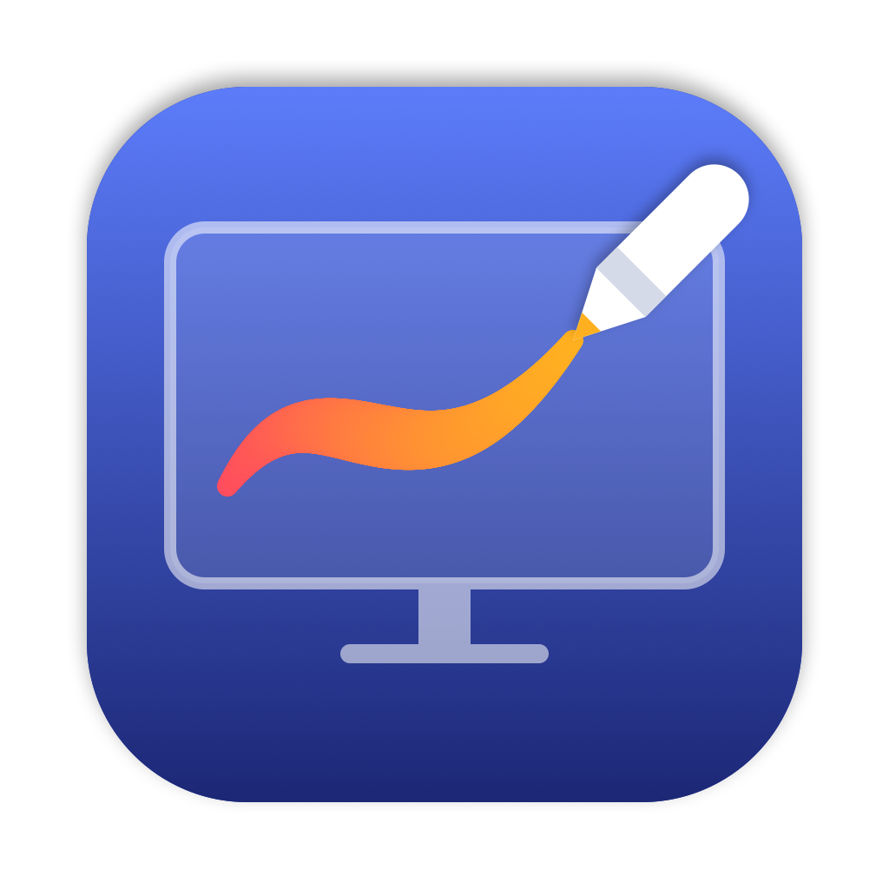
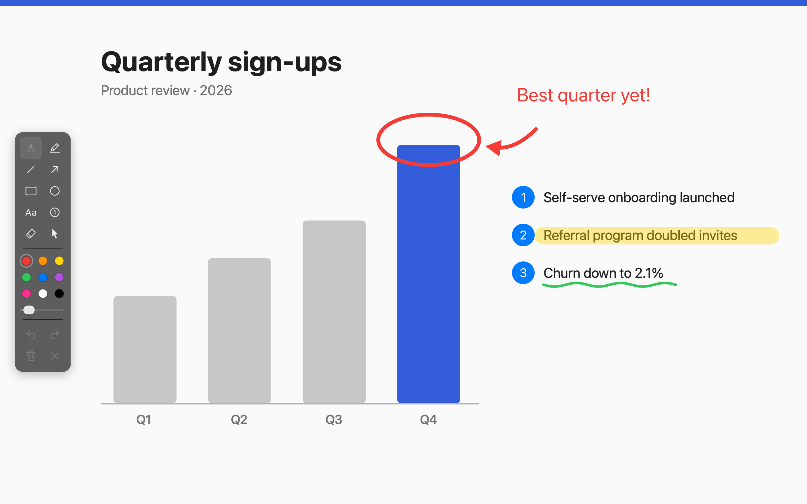
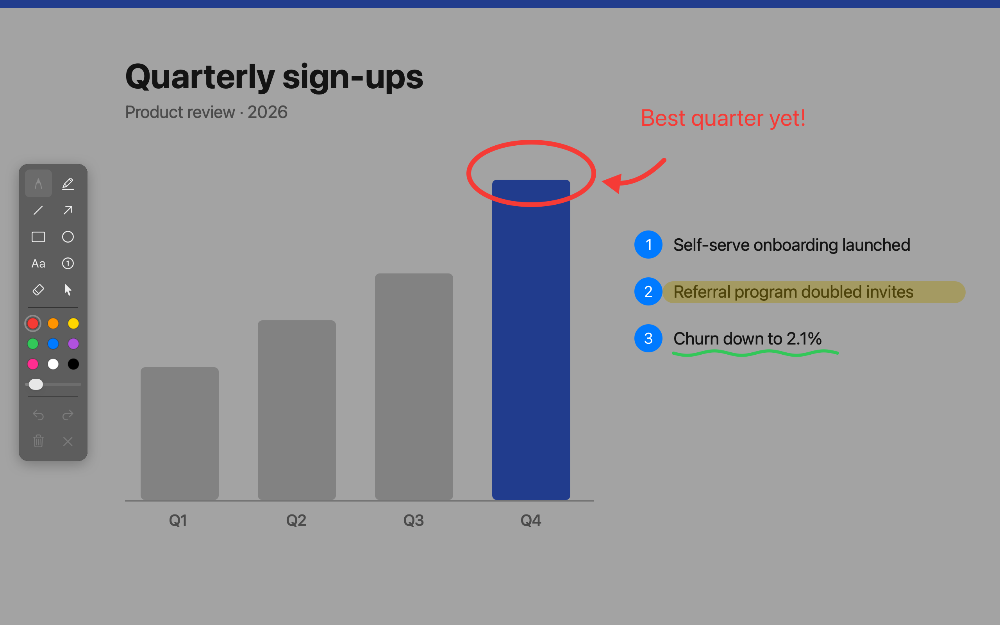

# ScreenInk

A macOS menu-bar app for drawing on top of the screen during presentations, demos and screen recordings.

Press **⌃⌥⌘A** (or pick **Draw on Screen** from the menu-bar icon) and every display gets a transparent canvas. Press **Esc** or the hotkey again to put it away.



With **Dim Screen While Drawing** on, the screen behind the ink darkens so annotations stand out:



## Features

- Pressure-sensitive pen, highlighter, line, arrow (straight or curved), rectangle, ellipse, text and numbered badges
- Eraser, selection (move, delete, recolor, bring to front), undo/redo
- Floating tool palette with 9 colors and a width slider
- Works over full-screen apps, on every Space and on all connected displays, and keeps each display's drawing when monitors are plugged in or out
- Menu-bar settings: auto-fade drawings after a few seconds, dim the screen while drawing, launch at login

## Requirements

- macOS 14 or later on Apple Silicon
- Swift 6 toolchain (Xcode or the Command Line Tools)

## Build and run

```sh
make install      # check this Mac and install the toolchain (Command Line Tools) if missing
make run          # build build/ScreenInk.app and launch it
make build        # build the app bundle only
make check        # unit tests + off-screen rendering self-test (what CI runs)
make screenshots  # re-render the README images in docs/images/
make icon         # re-draw the app icon (scripts/make-icon.swift)
make clean
```

The bundle is ad-hoc signed by default. To sign it for distribution, set `SIGN_ID="Developer ID Application: …"` when you run `scripts/build-app.sh`. Launch at Login only works for a signed app run from `/Applications`.

## Shortcuts while drawing

| Key | Action |
|---|---|
| P · H · L · A | Pen · Highlighter · Line · Arrow |
| R · O · T · N | Rectangle · Ellipse · Text · Numbered badge |
| E · V | Eraser · Select |
| 1–9 | Color (recolors the selection when one exists) |
| `[` · `]` | Thinner · Thicker |
| C | Clear all |
| ⌘Z · ⇧⌘Z | Undo · Redo |
| ⌘A · ⌘] | Select all · Bring to front |
| Delete | Delete the selection |
| Esc | Deselect, or stop drawing |

Hold **Shift** to constrain lines and arrows to 45° and rectangles/ellipses to squares/circles. Hold **⌥** with the pen for a temporary highlighter, or with the arrow for a curved arrow. Double-click text with the select tool to edit it.

## Project layout

- `Sources/ScreenInkCore`: model and geometry (no AppKit), unit-tested in `Tests/`
- `Sources/ScreenInk`: the AppKit app (overlay windows, tools, palette, menu)
- `PLAN.md`: scope, design decisions and roadmap
- `docs/images/`: README screenshots, rendered off-screen by `make screenshots`
